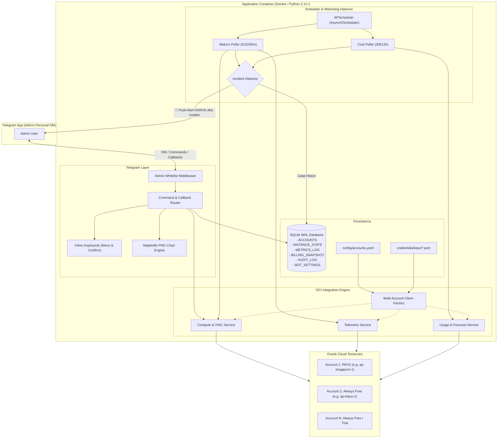
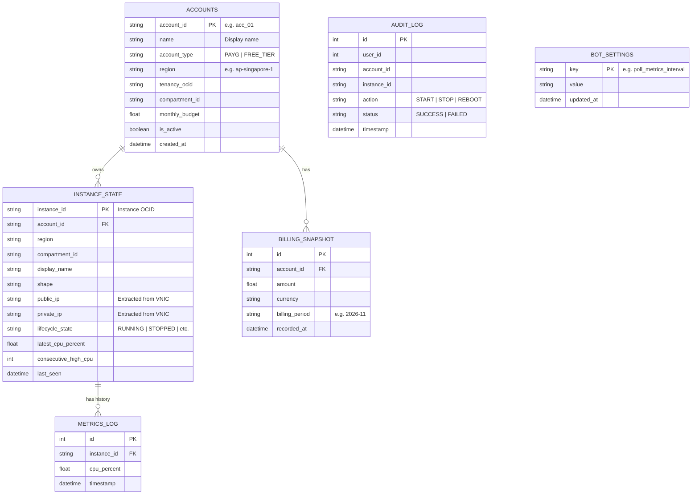

# OCI Multi-Account Telegram Monitoring Bot - Technical Specification

Dokumen spesifikasi arsitektur dan cetak biru teknis permanen (*Single Source of Truth*) untuk aplikasi **Telegram Bot Monitoring Multi-Akun Oracle Cloud Infrastructure (OCI)**.

---

## 1. Overview & Objective

Membangun aplikasi backend Python asinkron yang berfungsi sebagai:
1. **Interactive Telegram Bot**: Antarmuka kontrol dan pemantauan terpusat untuk **3 hingga 10 akun OCI** (kombinasi akun PAYG dan Always Free/Trial).
2. **Silent Incident Watchdog**: Background worker otonom yang memantau kesehatan compute instance dan akumulasi biaya secara periodik, tetapi **hanya mengirimkan push alert ke DM Admin jika terdeteksi insiden/anomali**.

---

## 2. Core Functional Requirements

### 2.1 Multi-Account Management (3–10 Akun)
- Mendukung isolasi konfigurasi per akun:
  - Tenancy OCID, User OCID, Fingerprint, Region, Compartment OCID.
  - Tipe Akun: `PAYG` vs `FREE_TIER` (Always Free / Trial).
  - Target `monthly_budget` (USD) per akun untuk alert pengeluaran.
- Kredensial disimpan dalam format deklaratif: `config/accounts.yaml` dengan file kunci privat `credentials/keys/*.pem`.
- Otomatis melakukan sinkronisasi metadata akun ke database SQLite (`ACCOUNTS` table) saat startup.

### 2.2 Periodic Health & Metrics Polling (Interval 5 / 10 / 30 Menit)
- **Status Lifecycle**: Polling status VM (`RUNNING`, `STOPPED`, `TERMINATING`, dll.) via `oci.core.ComputeClient`.
- **IP Address Resolution**: Mendapatkan **Public IP** dan **Private IP** dari VNIC attachments (`oci.core.VirtualNetworkClient`) dan menyimpannya di cache database.
- **Telemetry Query**: Mengambil utilisasi rata-rata CPU (%) via `oci.monitoring.MonitoringClient` (namespace `oci_computeagent`).
- **Silent Watchdog Rule**:
  - Jika seluruh VM berjalan normal dan CPU wajar, bot **tidak mengirim pesan apa pun** ke chat (hanya memperbarui SQLite).
  - Jika VM mati mendadak (`STOPPED` tak terduga) atau CPU `> 85%` selama 2 siklus berurutan, bot langsung mengirim **Push Alert** ke DM Admin Telegram.
  - Mengirim notifikasi **Recovery** jika instance kembali ke status `RUNNING`.

### 2.3 Interactive Compute Control & Security
- Perintah `/instances` menampilkan daftar VM interaktif (dengan Public IP, Region, status, CPU).
- Kontrol daya: `START`, `STOP`, dan `REBOOT` instance.
- **Two-Step Confirmation**: Wajib melalui dialog konfirmasi Inline Keyboard (`[✅ Ya, Lanjutkan]` / `[❌ Batalkan]`) sebelum aksi dikirim ke API OCI.
- Setiap aksi dicatat ke tabel `AUDIT_LOG`.

### 2.4 Billing, Cost Tracking & Linear Forecast (Interval 3 / 6 / 12 Jam)
- Mengambil akumulasi pengeluaran bulan berjalan (**Month-to-Date / MTD**) via `oci.usage_api.UsageapiClient`.
- **Linear Forecast**: Menghitung proyeksi pengeluaran hingga akhir bulan kalender:
  $$\text{Forecast} = \left(\frac{\text{Biaya Aktual (MTD)}}{\text{Hari Berjalan}}\right) \times \text{Total Hari Bulan Ini}$$
- **Free Tier Graceful Fallback**: Menangani akun Free Tier / Trial yang tidak memiliki riwayat tagihan atau memicu error `NotAuthorizedOrNotFound` secara elegan (menampilkan $0.00 tanpa error/crash).
- **Budget Exceeded Alert**: Mengirim push alert jika estimasi forecast akun PAYG melampaui `monthly_budget`.

### 2.5 Telegram UX & On-Demand Chart
- Whitelist ketat: Bot hanya merespons Telegram User ID yang terdaftar di `TELEGRAM_ADMIN_USER_ID`.
- Format pesan rapi berbasis HTML/Markdown dengan status emoji (🟢/🔴/🟡).
- Tombol `[📈 Lihat Grafik]` untuk membuat chart garis PNG (Matplotlib) utilisasi CPU 6–24 jam terakhir secara on-demand.
- Perintah `/settings` untuk mengubah interval polling (5/10/30m dan 3/6/12h) secara langsung tanpa restart aplikasi.

---

## 3. System Architecture & Component Diagram

---

## 4. Database Schema (SQLite WAL Mode)

---

## 5. Technical Stack

- **Runtime**: Python 3.11+
- **OCI SDK**: `oci>=2.120.0`
- **Telegram Bot Framework**: `python-telegram-bot>=21.0` (asyncio native)
- **Background Scheduler**: `APScheduler>=3.10.4` (`AsyncIOScheduler`)
- **Database ORM**: `SQLAlchemy>=2.0.0` + `aiosqlite>=0.20.0` (SQLite with WAL mode)
- **Data Modeling & Config**: `pydantic>=2.6.0`, `pydantic-settings>=2.2.0`, `PyYAML>=6.0`
- **Visualization**: `matplotlib>=3.8.0` (headless backend `Agg`)
- **Containerization**: Docker & Docker Compose
